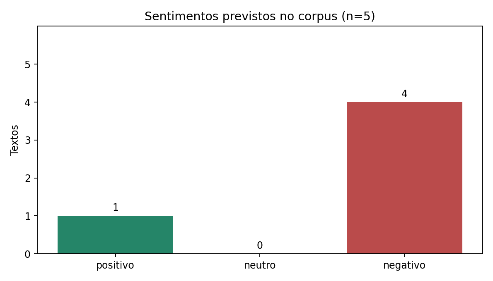
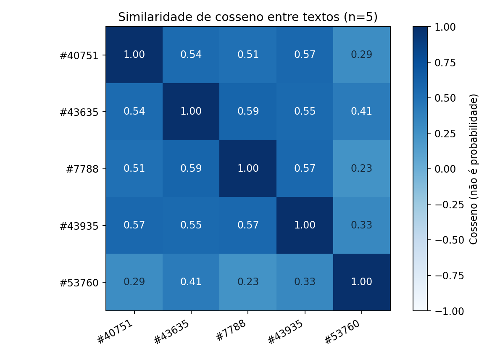

# VendeTexto - Etapa 2

Análise de requisitos de software em issues públicas do ERPNext, com pipeline
do spaCy, embeddings multilíngues, similaridade semântica e sentimentos.

**Disciplina:** Modelagem de Dados Não Estruturados, Ciência de Dados para
Negócios, UFPB. **Professora:** Adriana.

**Equipe:** Angélica Maria da Silva, Leonardo Pessoa de Souza e Davi Batista
Nóbrega Dias. A etapa 2 foi elaborada por Angélica e Davi, com revisão e
apoio técnico do ChatGPT. O código inicial foi elaborado por Angélica e está
preservado em `original/vendetexto2_angelica.py`. Leonardo integra a equipe
de apresentação.

## Entregas e resultados

- [Apresentação em PDF com 13 slides](apresentacao/etapa2-vendetexto.pdf).
- [Apresentação editável](apresentacao/VendeTexto_Etapa2_Apresentacao.pptx).
- [Resultados reais salvos no Windows](resultados_windows), incluindo coleta,
  análise offline, pedido em português e comparação com a etapa 1.
- [Código original de Angélica](original/vendetexto2_angelica.py) e
  [ajustes realizados](documentacao/AJUSTES_REALIZADOS.md).
- [Registro da validação no Windows](documentacao/VALIDACAO_WINDOWS.md).

Nos cinco relatos reais, o modelo previu quatro negativos e um positivo.
Esses são relatos de software, não avaliações de uma pesquisa de satisfação.





## Começar no Windows

1. Baixe o repositório em **Code → Download ZIP** e extraia o conteúdo inteiro para uma pasta normal. Não execute dentro do ZIP.
2. Use Python **3.12, 64 bits**. No terminal, `py -3.12 --version` confere a instalação.
3. Abra `instalar_windows.bat`. Ele cria `.venv`, instala as dependências,
   prepara os modelos e executa os testes básicos. A primeira instalação
   precisa de internet; os pesos dos dois modelos ocupam aproximadamente 1 GB.
4. Abra `executar_windows.bat`. A execução usa as cinco issues salvas e os
   modelos locais, com a etapa 2 habilitada.
5. Consulte o terminal e a pasta `saida`.

O ZIP contém código, dados, instruções, testes e resultados de exemplo reais.
Bibliotecas e pesos são baixados pelo instalador e não acompanham o ZIP.
O projeto foi verificado inicialmente em Linux/Python 3.12. Em seguida,
Davi executou no Windows com Python 3.12.10, confirmou `pip check`, preparou
os modelos, realizou as análises e obteve **16 testes aprovados**. Esse registro
foi informado pela equipe durante a preparação da apresentação. Os arquivos
dessas execuções estão em [`resultados_windows`](resultados_windows).
Quem já instalou o projeto no mesmo computador não precisa instalar de novo.

Se preferir o terminal do VS Code ou PowerShell, abra a pasta extraída e use:

```powershell
py -3.12 -m venv .venv
.\.venv\Scripts\python.exe -m pip install -r requirements-torch-cpu.txt
.\.venv\Scripts\python.exe -m pip install -r requirements.txt
.\.venv\Scripts\python.exe vendetexto2.py --modo preparar
.\.venv\Scripts\python.exe vendetexto2.py --modo cache --offline
```

Os exemplos abaixo usam `python`. No Windows, substitua por
`.\.venv\Scripts\python.exe` se o ambiente não estiver ativado. Não é preciso
alterar a política do PowerShell nem executar como administrador.

Em Linux, crie o ambiente com `python3 -m venv .venv` e use `.venv/bin/python`
nos mesmos comandos de instalação e execução.

## Comandos e opções

Preparar os modelos, uma vez, com internet:

```bash
python vendetexto2.py --modo preparar
```

Executar toda a etapa 2 com as cinco issues reais salvas, sem nova consulta:

```bash
python vendetexto2.py --modo cache --offline
```

Executar exemplos inventados e acrescentar um pedido em português:

```bash
python vendetexto2.py --modo demo --offline --produto Caneca --requisito "Quero um painel com preço de R$ 12,00 e 80 unidades vendidas" --saida saida_demo
```

Refazer a coleta das cinco issues pela API pública do GitHub:

```bash
python vendetexto2.py --modo coletar --saida saida_coleta
```

Reexecutar apenas o processamento e os indicadores herdados da etapa 1:

```bash
python vendetexto2.py --modo cache --somente-etapa1 --saida saida_etapa1
```

Abrir a calculadora, também herdada da etapa 1:

```bash
python vendetexto2.py --modo calculadora
```

Conferir todas as opções:

```bash
python vendetexto2.py --help
```

| Opção | Comportamento |
|---|---|
| `--modo cache` | Lê o snapshot das cinco issues reais incluído em `dados`. É o padrão. |
| `--modo demo` | Lê os cinco exemplos inventados. |
| `--modo coletar` | Consulta novamente a API e salva `issues_api.json` na saída. Requer internet. |
| `--modo preparar` | Baixa/carrega e salva os dois modelos em `modelos`. Não analisa as issues. |
| `--modo calculadora` | Pede dados de demanda, cruzada e oferta. Não analisa textos. |
| `--produto Caderno` ou `Caneca` | Escolhe o produto do CSV fictício, separado das issues. |
| `--requisito "..."` | Acrescenta uma consulta em português. Não altera as contagens do corpus. |
| `--analise-avancada` | Mantida por compatibilidade. A etapa 2 já está habilitada por padrão. |
| `--somente-etapa1` | Desativa sentimentos e embeddings explicitamente. Não demonstra a etapa 2. |
| `--offline` | Exige os modelos locais e impede nova coleta. Preparar os modelos antes. |
| `--modelos PASTA` | Muda a pasta de pesos locais, para preparar e depois executar. |
| `--saida PASTA` | Define onde gravar resultados. O padrão é `saida`, ou `saida_etapa1` no modo básico. |

As opções de análise textual não se aplicam aos modos `calculadora` e `preparar`.
Reutilizar uma mesma pasta de saída substitui os arquivos de mesmo nome. Use
pastas diferentes para comparar execuções. `resumo.json` identifica o modo e
se a etapa 2 foi executada naquela rodada.

## Como o código atende à etapa 2

### Pipeline do spaCy

`criar_analisadores()` configura, nos dois idiomas:

1. O tokenizador próprio de `spacy.blank("pt")` ou `spacy.blank("en")`.
2. `sentencizer`, que encontra limites de sentenças.
3. `requisitos_vendetexto`, componente próprio registrado com `Language.factory`.

O componente de requisitos usa o `PhraseMatcher` da base original, anota
expressões e contextos no `Doc` e devolve o documento. As sentenças alimentam
a fragmentação dos modelos. Assim, os componentes participam realmente da
análise e seus nomes e saídas aparecem no terminal e no JSON.

Esta pipeline é **baseada em regras**. Não treina um classificador e não
produz lemas, entidades ou dependências sintáticas estatísticas. Não requer
download de `pt_core_news_sm` ou `en_core_web_sm`. A busca de substrings usada
como substituto silencioso foi removida: se spaCy faltar, o programa informa
o problema e interrompe a análise textual.

### Embeddings e análise semântica

Preservamos o modelo escolhido na base da Angélica:
`sentence-transformers/paraphrase-multilingual-MiniLM-L12-v2`.

O programa gera vetores normalizados de **384 dimensões**. Textos longos são
divididos em fragmentos que cabem nos tokenizadores dos DOIS modelos. A
divisão preserva todas as palavras do texto limpo, sem duplicação e sem corte
silencioso. Um ajuste conserva também palavras marcadas em Markdown quando
o spaCy identifica um limite no interior de uma sequência sem espaço.

Os embeddings de fragmentos são combinados por uma média ponderada pela
quantidade de tokens do tokenizador de embeddings, sem tokens especiais.
O vetor resultante é normalizado novamente. Para vetores unitários:

`similaridade de cosseno(u, v) = produto escalar(u, v)`.

O ranking exclui o próprio texto e inclui até três vizinhos, com título, ID,
link e score. O pedido do usuário pode buscar vizinhos no corpus, mas nunca
entra como candidato dos demais relatos. A matriz exportada contém todos
os textos, enquanto o gráfico mostra somente o corpus.

### Sentimentos e Transformers

Também preservamos `lxyuan/distilbert-base-multilingual-cased-sentiments-student`.
`transformers.pipeline` retorna as probabilidades de positivo, neutro e
negativo por fragmento. A previsão do documento usa a média dessas
probabilidades, ponderada pelos mesmos pesos dos embeddings. A classe com
maior média recebe o rótulo final. O terminal chama esse valor de **score
agregado**, que não mede a taxa de acerto do projeto.

Usamos CPU, lotes de até oito fragmentos e revisões fixas dos modelos. Depois
de `--modo preparar`, os modelos vêm de diretórios locais. Com `--offline`
não há download ou consulta à API. Na versão de Transformers fixada, uma
detecção de regex Mistral pode atingir modelos locais não Mistral; definimos
`fix_mistral_regex=False` para preservar os tokenizadores Unigram/WordPiece
desses modelos, sem aplicar a eles uma correção destinada a outra família.

## Resultados gerados

| Arquivo | Conteúdo |
|---|---|
| `analise.json` | Texto limpo, categorias, sentenças, pipeline, contexto, previsões, fragmentos e ranking. |
| `resumo.json` | Data da execução, hash da entrada, parâmetros gerais, contagens e limites. |
| `sentimentos.csv` | Classe e distribuição agregada por texto, com quantidade de fragmentos. |
| `similaridade.csv` | Matriz de cosseno; IDs na primeira linha e coluna. |
| `embeddings.npy` | Vetores de documentos na mesma ordem de `analise.json`. |
| `sentimentos.png` | Distribuição das classes previstas no corpus, sem a consulta do usuário. |
| `similaridade.png` | Matriz de similaridade do corpus, sem a consulta do usuário. |
| `categorias_issues.png` | Categorias da etapa 1. |
| `faturamento.png` | Receita fictícia do produto escolhido. |

As saídas avançadas só são geradas com a etapa 2 habilitada. Em
`resultados_exemplo` há saídas reais salvas desta revisão, identificadas como
exemplos e separadas da pasta de uma nova execução.

## Testes e verificação

Testes básicos, sem downloads ou nova coleta:

```bash
python -m unittest discover -s testes -v
```

Os quatro testes de modelos reais são pulados por padrão. Para executá-los
com os modelos já preparados, no PowerShell:

```powershell
$env:VENDETEXTO_TESTAR_MODELOS="1"
.\.venv\Scripts\python.exe -m unittest discover -s testes -v
```

Em Linux:

```bash
VENDETEXTO_TESTAR_MODELOS=1 python -m unittest discover -s testes -v
```

Conferir a calculadora: digite `50`, `40`, `100`, `109`, `s`, `100`, `112`,
`s`, `100`, `95`, uma entrada por vez. Esperado: demanda 0,45, cruzada +0,75
e oferta +0,25. Caderno mantém receita 1000 para 960 e elasticidade 1,00.
Caneca mantém receita 1000 para 1056 e elasticidade 0,40.

O registro de testes, ambiente e limitações está em `documentacao/VALIDACAO.md`.
Os casos de controle positivo/negativo testam o funcionamento da inferência;
não estabelecem acurácia em issues técnicas.

## Limites da interpretação

- São cinco issues escolhidas, e não uma amostra representativa de todos os usuários.
- Sentimento não é prioridade, severidade, satisfação comercial nem intenção de compra.
- O score agregado não é uma probabilidade calibrada de acerto.
- Os vizinhos são um ranking relativo. Não existe um limiar validado de duplicidade.
- A combinação de fragmentos é uma aproximação do significado e tom do documento.
- O corpus real, os exemplos inventados e o CSV fictício têm funções distintas.
- As análises não demonstram causalidade entre alterações de preço e vendas.

## Se aparecer um erro

**“spaCy/dependências indisponíveis”:** use o Python de `.venv` e repita o instalador.

**“Modelos locais incompletos”:** prepare com internet antes de usar `--offline`.
Se um download foi interrompido, remova somente a subpasta do modelo
incompleto (`modelos/embeddings` ou `modelos/sentimentos`) e prepare de novo.

**Arquivo de dados não encontrado:** extraia o pacote inteiro. A pasta `dados`
deve permanecer junto a `vendetexto2.py`. O terminal pode estar em outra pasta,
pois as entradas são localizadas a partir do caminho do próprio programa.

**Falha na API:** verifique conexão/limite da API ou use `--modo cache`. Não há
substituição silenciosa de uma coleta atual por um snapshot antigo.

**Computador novo ou primeiro uso:** os modelos não vêm dentro do ZIP. A
preparação deve acontecer antes da apresentação, com internet disponível.

## Estrutura e fontes

`vendetexto2.py` é o ponto de entrada e conserva o código acessível em um
arquivo para a apresentação. `dados` contém as duas bases textuais e o CSV.
`documentacao` registra ajustes, metodologia, validação e autoria. `testes`
contém verificações reproduzíveis. `original` conserva a versão recebida.
`resultados_windows` conserva as execuções fornecidas por Davi; novas rodadas
continuam sendo gravadas nas pastas indicadas por `--saida`. `apresentacao`
contém os slides aprovados. O instalador cria `.venv` e `modelos`; o programa
cria a pasta de saída. Bibliotecas, modelos e caches não são versionados.

O registro de Linux em `documentacao/VALIDACAO.md` é histórico. O complemento
do Windows está em `documentacao/VALIDACAO_WINDOWS.md`.

- Etapa 1: https://github.com/davibndiasdata/VendeTextoEtapa1
- Pipeline: https://spacy.io/usage/processing-pipelines
- Sentence Transformers: https://sbert.net/docs/package_reference/sentence_transformer/SentenceTransformer.html
- Embeddings: https://huggingface.co/sentence-transformers/paraphrase-multilingual-MiniLM-L12-v2
- Sentimentos: https://huggingface.co/lxyuan/distilbert-base-multilingual-cased-sentiments-student
- Transformers: https://huggingface.co/docs/transformers/main_classes/pipelines

Não há áudio ou vídeo nesta entrega: essas análises pertencem à etapa 3.
